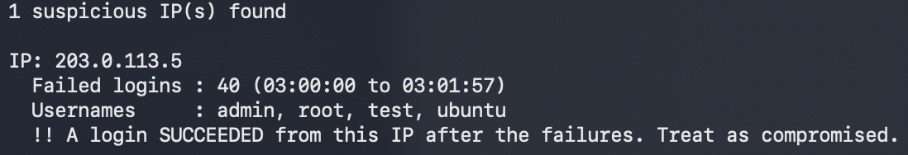

# SSH Brute-Force Detector

A Python tool that reads a Linux SSH login log, finds IP addresses that
look like brute-force attacks, and tells you whether any attacker got in.

## What it does
- Flags any IP with 10+ failed logins within 5 minutes (both adjustable)
- Lists the usernames the attacker tried (root, admin, ...)
- Warns when a login succeeded after the failures, which means the
  account may be compromised
- Ignores normal users who mistype a password

## Run it
Needs Python 3, no extra packages.

    python3 make_sample_log.py              # creates a fake log (optional)
    python3 test_analyzer.py                # runs the checks
    python3 log_analyzer.py sample_auth.log

Stricter settings:

    python3 log_analyzer.py sample_auth.log --threshold 5 --window 60

## Example output
    1 suspicious IP(s) found

    IP: 203.0.113.5
      Failed logins : 40 (03:00:00 to 03:01:57)
      Usernames     : admin, root, test, ubuntu
      !! A login SUCCEEDED from this IP after the failures. Treat as compromised.

## How it works
1. Each log line is matched with a regular expression to get the time,
   result (failed or accepted), username and IP.
2. Failures are grouped by IP and sorted by time.
3. A sliding window checks whether any N failures fall within the
   time limit. That means a fast burst is flagged, but a slow trickle
   over many hours is not (use a bigger window to catch those too).
4. For flagged IPs, it checks for a success after the first failure.

## Sample data
`sample_auth.log` is fully fake. It has one fast attacker, one slow
attacker and normal users. The IPs use ranges reserved for documentation.

## Limitations
- Only reads the standard OpenSSH `sshd` password log format
- Does not detect failed logins by SSH key or other services
- Log lines have no year, so the current year is assumed

## Ideas to extend
- Export results as CSV
- Look up the country of each attacker IP
- Generate a firewall block list
